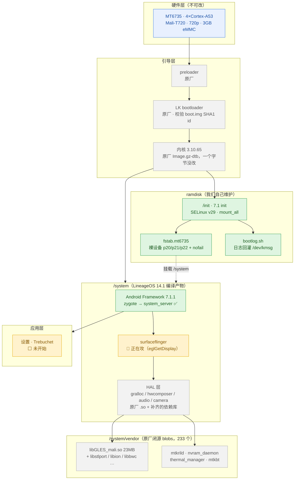

<p align="center">
  
</p>

<h1 align="center">GIONEE-Phoenix</h1>

<p align="center">
  <em>金立手机运行LineageOS项目</em>
</p>

<p align="center">
  <a href="#状态"></a>
  <a href="#"></a>
  <a href="#"></a>
  <a href="#"></a>
  <a href="#license"></a>
</p>

---

厂商没了，OTA 服务器早关了，最后一版固件是老旧的安卓版本

> **主线：LineageOS 14.1 / Android 7.1，使用原厂 3.10 内核。**
> 15.1 / 8.1 线已暂停：HIDL 需要 `/dev/hwbinder`、`/dev/vndbinder`，
> 而原厂 3.10 内核只有 `/dev/binder`，重编内核成本过高。

---

## 系统架构总览

这张图回答一个问题：**哪些层是我们能换的，哪些必须保留原厂**。

这台机器上「原厂」与「LineageOS」各自占据哪一层，决定了哪些东西能换、哪些不能动。
**绿色**是已经由 LineageOS 14.1 接管并验证通过的部分，**橙色**是当前正在攻的关卡，
**灰色**仍是原厂二进制（有意保留，减少变量）。



**读图要点**

| 层 | 谁提供 | 能不能换 |
|---|---|---|
| preloader / LK | 原厂 | ❌ 换了会变砖，且 LK 校验 boot.img 头部的 SHA1 `id` |
| 内核 3.10.65 | 原厂 `Image.gz-dtb` | ❌ 没有源码树，且这颗内核只认原厂那套 ramdisk 结构（实测：换成 omni 的 416 条目 ramdisk 直接引导不了） |
| ramdisk | **我们**（`phoenix/rootdir/`） | ✅ 但必须用原厂 init，否则 SELinux 无法切 permissive |
| `/system` | **LineageOS 14.1 编译** | ✅ 这就是移植的主体 |
| `/system/vendor` | 原厂 blobs | 🔶 能用则用；缺依赖时从原厂固件补（如 `libstlport.so`） |

> 一句话概括移植策略：**下层全部保留原厂，只替换 `/system`**。
> 所有内核侧的限制都靠 ramdisk 配置和 CI 源码补丁绕开，而不是重编内核。

---

## 状态

| 阶段 | 内容 | 状态 |
|---|---|---|
| M0 | 固件解剖、分区表、硬件档案 | ✅ 完成 |
| M1 | TWRP 可启动、中文界面、能读 TF 卡 | ✅ 可用（13.3 MB，装进 16 MB 分区） |
| M2 | LineageOS 14.1 全量编译出包 | ✅ `system.img` 3.0 GB(raw) + `boot.img`，能刷进机器 |
| M2b | **14.1 开机启动链 bring-up** | 🔧 **进行中**，见下 |
| M3 | 显示 / 触摸 / WiFi / 音频 / 相机 | ⬜ 未开始 |
| M4 | 更新版本 | ⬜ 未开始 |

### 当前卡点：`mount_all` 之后的阶段不透明

前几关（LK → 内核 → SELinux v29 → `mount_all`）已逐一用 `/proc/last_kmsg` 打通。
现在的问题不是"猜不到卡在哪"，而是**失败时不留痕迹**：

1. `fs_mgr_mount_all()` 只在 `error_count` 非 0 时返回 -1，init 收到后只打一句
   `unexpected error`，**不会 queue `nonencrypted`** —— 而
   `class_start main`（zygote / servicemanager / surfaceflinger 全在 main 类）
   就在那个动作里。于是整机**静默卡在第一屏**。
   已在 fstab 里给各分区加 `nofail`：单分区挂不上只留一行日志，不再拖死启动链。
2. `/proc/last_kmsg` 是 MTK ram console 的 64 KB 环形缓冲，
   **硬断电（长按电源）就整块丢失**，只能读到全 NUL。
   → 改成往 `/cache` 写 checkpoint 与日志，并在每个阶段
   `write /dev/kmsg "gn3002: ..."` 打点，这样即使 `/cache` 没挂上也有据可查。

详见 [`../docs/DEBUG-LOG.md`](../docs/DEBUG-LOG.md) 的 B14–B17，
以及 [`rootdir/init.mt6735.rc`](rootdir/init.mt6735.rc) 里逐段写的注释。

> 历史上 8.1 卡在 `FirstStageMount` 只读设备树 `/firmware/android/fstab` 那一段，
> 修复脚本是 [`ci/patch-first-stage.py`](ci/patch-first-stage.py)；
> 8.1 线已暂停，该结论仅留档（14.1 不走 FirstStageMount，见 DEBUG-LOG B14）。

---

## 硬件

| | |
|---|---|
| SoC | MT6735，4×Cortex-A53 @1.3GHz，Mali-T720 MP2 |
| 代号 | `gbl7356`（原厂 `ro.product.device` = `GIONEE_GBL7356`） |
| 屏幕 | 720×1280，天马 `tm_ft8606`（触摸一体），320dpi，**BGR 排列** |
| 内存/存储 | 2 GB / 16 GB eMMC，system 3 GB |
| 用户空间 | 64 位（`zygote64_32`） |
| 内核 | 3.10.65，arm64，原厂 `Image.gz-dtb`，**不改** |
| 安全 | ATF + trustzone，bootloader 已解锁 |
| 相机 | 前 + 后，MTK legacy HAL1（`camera.mt6735.so`） |
| 连接 | MTK WMT WiFi/BT combo、pn54x NFC、CCCI 双卡 LTE |

### 内核加载地址（全部来自原厂 boot.img header 实测）

```
kernel_addr   0x40080000   → base 0x40000000 + offset 0x00080000
ramdisk_addr  0x44000000   → offset 0x04000000
tags_addr     0x4e000000   → offset 0x0e000000
page_size     2048
```

> `0x80000` 这个 offset 是最容易翻车的地方。Android 默认给 `0x8000`，
> 而 MT6735 前面 512 KB 被 LK 和 ATF 占了。写错的表现：刷完开机黑屏、几秒后自己复位、
> 没有任何日志。

---

## 目录

仓库根目录**就是** device tree，由 `manifest/phoenix.xml` 的
`path="device/gionee/gbl7356"` 映射进源码树。所以 `BoardConfig.mk` 在顶层。

```
.
├── BoardConfig.mk           板级配置（注释密度很高，每个坑都写在里面）
├── device.mk                包、文件拷贝、HAL 变量
├── lineage.mk               产品定义（必须叫这个名字，见下）
├── AndroidProducts.mk       lunch 目标注册
├── omni_gbl7356.mk          M1 TWRP 的产品定义
├── twrp.fstab               TWRP 分区挂载表
├── ci/                      ★ 构建期源码补丁（libsepol / init / first-stage）
├── blobs/                   233 个原厂闭源文件（86 MB）
├── rootdir/                 init.mt6735.rc / ueventd.mt6735.rc / fstab.mt6735
├── configs/                 audio_policy / media_codecs / thermal
├── prebuilt/Image.gz-dtb    原厂内核，6,928,802 字节，一个字节没改
├── manifest/phoenix.xml     local manifest
├── tools/ci-patch-tree.sh   TWRP 构建时的源码级瘦身
└── .github/workflows/       build-lineage.yml / build-twrp.yml
```

---

## 硬约束

| 项 | 值 | 影响 |
|---|---|---|
| 内核 | 原厂 3.10.65，不改 | 只有 `Image.gz-dtb`，没源码树；所有内核限制都用源码补丁绕过 |
| boot / recovery 分区 | 各 16 MB | boot 7.8 MB、recovery 13.9 MB |
| system 分区 | 3 GB | raw 3.0 GB，**没有余量** |
| userdata | 1.5 GB | 装不下 3 GB 卡刷包，只能 fastboot / SPFT / TWRP 刷镜像 |
| vendor 分区 | 无 | 非 Treble，`TARGET_COPY_OUT_VENDOR=system/vendor` |
| SELinux | 内核只支持策略 **15–29** | 8.1 默认 v30，必须 `POLICYVERS := 29` + libsepol 补丁 |
| 内核 DTB | 无 `/firmware/android/fstab` | 第一阶段挂载会跳过，必须打补丁 |
| 内核 | 无 devtmpfs、无 `mmap_rnd_bits` | `/dev` 靠 ueventd 建；init 硬化检查会 panic |

---

## 编译

### GitHub Actions（推荐）

```bash
# 全量（约 1 小时）
gh workflow run "LineageOS 15.1" -R Windy-Xiaofei/gn3002-phoenix --ref main

# 只打 boot.img（约 10 分钟，调 ramdisk / cmdline 时用）
gh workflow run "LineageOS 15.1" -R Windy-Xiaofei/gn3002-phoenix --ref main -f target=bootimage

# 取产物
gh run download <run-id> -R Windy-Xiaofei/gn3002-phoenix -n lineage-gbl7356-<n> -D out/boot
```

推送这些路径会自动触发：`device.mk`、`lineage.mk`、`AndroidProducts.mk`、
`BoardConfig.mk`、`blobs/**`、`rootdir/**`、`configs/**`、`overlay/**`、`sepolicy/**`、
本工作流文件。`concurrency` 是 `cancel-in-progress`，**推送会取消正在跑的那一轮**。

### 本地

需要 Ubuntu 20.04/22.04、≥120 GB 磁盘、≥16 GB 内存、JDK 8、python2.7。

```bash
repo init -u https://github.com/LineageOS/android.git -b lineage-15.1 --depth=1
repo sync -c -j8 --force-sync --no-clone-bundle --no-tags

mkdir -p device/gionee/gbl7356
rsync -a --exclude=.git ./ device/gionee/gbl7356/

sudo ln -sf "$(command -v python2.7)" /usr/local/bin/python   # 8.1 脚本是 py2 语法
source build/envsetup.sh
lunch lineage_gbl7356-userdebug
mka bootimage -j$(nproc)
```

TWRP（M1）走另一套 manifest：

```bash
repo init -u https://github.com/minimal-manifest-twrp/platform_manifest_twrp_omni.git \
          -b twrp-8.1 --depth=1
lunch omni_gbl7356-eng
mka recoveryimage
```

---

## 刷入

产物：`boot.img`（7.8 MB）、`recovery.img`（13.9 MB）、`system.img`（3.0 GB raw）。

### fastboot（改 boot 时最快）

```bash
fastboot devices
fastboot flash boot boot.img
fastboot reboot
```

成功失败都会明确报出来，比 SP Flash Tool 的静默失败好定位。

### SP Flash Tool（整包）

关机 → 加载 scatter（只勾 boot / recovery / system）→ **Download Only** →
Start → **然后才插线**。

> **永远不要刷 preloader、lk、nvram、protect1/2**。sparse 格式的 `system.img`
> SPFT 不认，必须先转 raw。

### TWRP（只有 TF 卡时）

TWRP → 安装 → **安装镜像** → 选 `system.img` → 目标 **System Image**；
再选 `boot.img` → 目标 **Boot**。最后 **格式化 Data**（不是「清除 Data」，
后者是文件级删除，5.1 的加密分区挂不上就必然失败）。

> ⚠️ **必须格式化 Data，不能只覆盖 system.img**（2026-11-28 实测）：
> 保留旧 `/data` 直接刷新 system 会「进到桌面就黑屏关机」。原因有两层：
> - `/data/property` 里持久化的旧属性（`persist.*`）会覆盖新 default.prop；
> - 旧 App 的数据库版本与新 system 里的 App 不匹配，
>   例如 `com.android.email` 从 v140 库配 v131 App，崩溃循环拖垮桌面。
> 只有格式化 Data 才能让新系统从干净状态冷启动。代价是手机里的数据全清 —
> 重要资料（IMEI/NVRAM 在独立分区，不受影响）之外的用户数据请先备份。

### 一个历史坑：原厂恢复自恢复

原厂 `init.rc` 里有 `service flash_recovery /system/bin/install-recovery.sh`，
每次正常开机都会校验 recovery 分区 SHA1，不是原厂就用 `boot` +
`/system/recovery-from-boot.p` 把原厂 recovery 写回去。
所以在只刷 recovery、没刷 system 的阶段，「刷成功、进系统后又被还原」是这个机制。
刷了 8.1 的 system.img 之后这些脚本就不存在了。

---

## 已知问题

| 问题 | 状态 |
|---|---|
| surfaceflinger 反复 SIGABRT | **当前卡点**。递归展开依赖链后定位到第三层 `libdpframework.so → libpq_prot.so` 缺失，已补，待验证 |
| TWRP 里 `adb shell` / 终端不可用 | 已知。SELinux 不允许 adbd 执行 `rootfs` 标签的 `/sbin/sh`，原厂 init 又无法切 permissive |
| TWRP 下 `/data` 读不到 | 已知。TWRP 用 `resuid=10010` 挂载，adbd(uid 2000) 读到 0 字节 |
| `hwcomposer.mt6735.so` 符号对不上 | 已知。`GraphicBufferMapper::lock` 是 5.1 旧签名，`__xlog_buf_printf` 是 MTK 私有导出。HWC 走 dlopen，有软件合成兜底 |
| `sdcardfs` / `memfd_create` 缺失 | 未验证，可能要动内核 |
| camera1 → camera3、RIL v6 → v11 | 未开始 |

已解决：

| 问题 | 做法 |
|---|---|
| TWRP CPU 温度不准 | 原来写死 `thermal_zone1`，那是 PMIC 传感器。实测本机 `thermal_zone7 = mtktscpu` 才是 CPU，改为按 `thermal_zoneN/type` 自动识别 |
| TWRP 中英文无法切换 | `ui.xml` 里硬编码 `tw_language` 会覆盖持久设置；改为编译期默认值 + 用户选择写 `/data/recovery/.twrps` |
| TWRP 电量读数 | `capacity` 读失败时按千分比归一，再兜底 `charge_counter/charge_full` |

---

## 警告

自用项目，不是发行版。没有 OTA，没有签名，没有质量保证。
你的机器可能变砖，虽然目前每次都能救回来。

刷机前请确认手上有原厂固件包和一根能用的数据线。

---

## 致谢

- [Coolpad mt6735-common](https://github.com/coolpadnote3litedevelopment/android_device_coolpad_mt6735-common)
  — MT6735 设备树的事实标准，本项目的 BoardConfig 大量参考
- TWRP minimal manifest
- 以及那台 2016 年出厂、至今还在服役的 GN3002
- Deepseek V4.1 Flash
## License

MIT，见 [LICENSE](LICENSE)。

`blobs/` 下的闭源二进制来自原厂固件，版权归各自权利人，仅用于让这台机器重新开机，
不适用 MIT 协议。
